# Think Audio Visual — scraped content

Source: https://thinkaudiovisual.co.za/ (scraped 2026-11-23)

---

# Page: index.html

- Home
- About us
- Services
- Contacts

##  

### Reliable at all times!

-  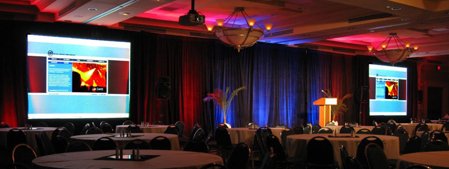
-  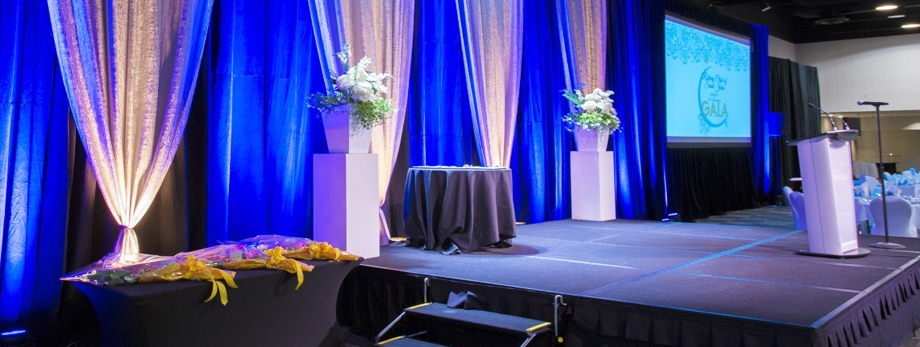
-  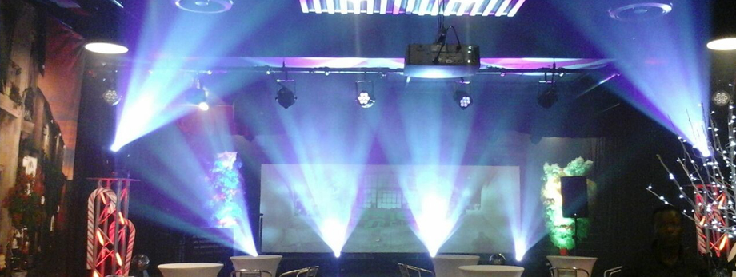

Think Audio Visual is a Durban - based audio visual company that specializes with sound, AV, stage and lighting. Our service are rendered on different types of events including conferences, live events, meetings, houses of worship, weddings and parties all over South Africa.

#### Popular Setup Projects

-
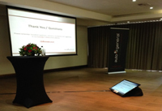

-
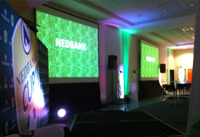

-
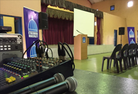

-
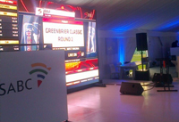

-
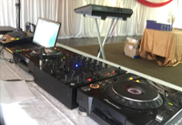

-
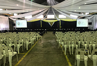

-
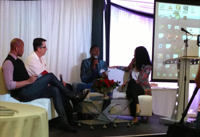

-
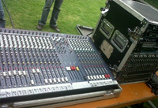

#### Shortly About Us

Under the management of a skilled and experience owner - director Mr T. Masango, our clients are guaranteed to get optimum services at all times. The experience of over 10 years in sound and audio visual shows dedication and passion for the industry.
read more

#### Our Core Values

- When doing business with Think Audio Visual, you’re assured that your business is handled by honest, friendly and skilled professionals who are passionate about providing unsurpassed quality services that keeps you coming back for more.
- We endeavor to find the most cost effective solutions for ourselves and our clients in order to ensure that we provide quality service at reasonable price.
- We always strive to provide services that yield the desired results in the shortest possible time.

#### Our Locations
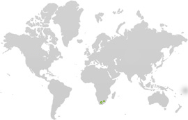  our vision is to become the most renowned professional audio visual company in South Africa.

Think Audio Visual © 2017
Web Design by by BDS Creative | Think Audio Visual

---

# Page: about.html

- Home
- About us
- Services
- Contacts

##  

### Reliable at all Times!

#### Popular Setup Projects

-

-

-

-

-

-

-

-

#### Few Words About Us

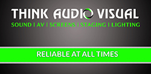

Think Audio Visual
Under the management of a skilled and experience owner - director Mr T. Masango, our clients are guaranteed to get optimum services at all times. The experience of over 10 years in sound and audio visual shows dedication and passion for the industry.

#### Mission Statement

We are reliable at all times

Our vision is to become the most renowned professional audio visual company in South Africa.

- To provide reliable services to our clients at all times.
- To achieve our clients goals by recommending correct equipment for their events.
- To ensure good relationship with our clients no matter how big or small.

Let us decorate your event
With our professional and reliable equipment

#### Core Values

- Integrity : When doing business with Think Audio Visual, you’re assured that your business is handled by honest, friendly and skilled professionals who are passionate about providing unsurpassed quality services that keeps you coming back for more.
-  Cost Reduction : We endeavor to find the most cost effective solutions for ourselves and our clients in order to ensure that we provide quality service at reasonable price.
-  Improved Quality : We pride ourselves in our revolutionary research capabilities to ensure that we provide the best service possible within a particular budget.
-  Time to Market : We always strive to provide services that yield the desired results in the shortest possible time.

Think Audio Visual © 2017
Web Design by by BDS Creative | Think Audio Visual

---

# Page: services.html

- Home
- About us
- Services
- Contacts

##  

### Reliable at all Times!

#### Our Services

Audio Visual

- Fastfold Screens
- Data Projectors
- Laptops
- Presentation Aids
- Daylight Screens
- Video Recording & Projection

Sound

- PA Systems
- Live Performances
- Backline (Bands)
- Dj’ying
- Audio Recording
- Conference mics

Stage

- Performance Stage
- Fashion Show Stage
- Podium Raising
- Main Table Stage
- Podiums

Lighting

- Stage Lights
- Up Lights
- Décor Lights
- Disco Lights

#### Our Previous Setups

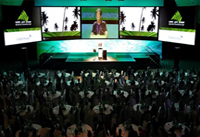

Video Recording & Projection

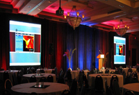

Presentation Aids

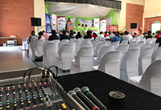

PA Systems

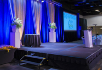

Stage & Podium Raising

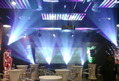

Stage Lights & Up Lights

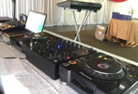

Dj’ying

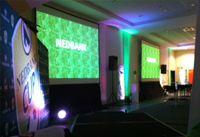

Fastfold Screens

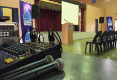

Meetings

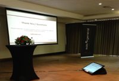

Data Projectors, Laptops, Presentation Aids

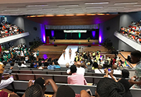

Fashion Shows

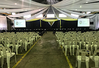

Audio Visuals

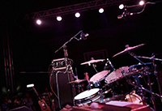

Live Bands

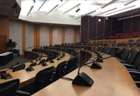

Conference Microphones

Think Audio Visual © 2017
Web Design by by BDS Creative | Think Audio Visual

---

# Page: contacts.html

- Home
- About us
- Services
- Contacts

##  

### Reliable at all Times!

For More information/Quote Our contact details are listed below, or just fillin the form below.

#### Our Contacts

78 Carnforth Avenue, Bonela, Durban, 4091 Cell phone: +27 83 418 0085 Telephone: +27 31 8111 311 Email: admin@thinkaudiovisual.co.za

#### Contact Form
Your Name: Your Email:

Your Message:

clear send

Think Audio Visual © 2017
Web Design by by BDS Creative | Think Audio Visual
